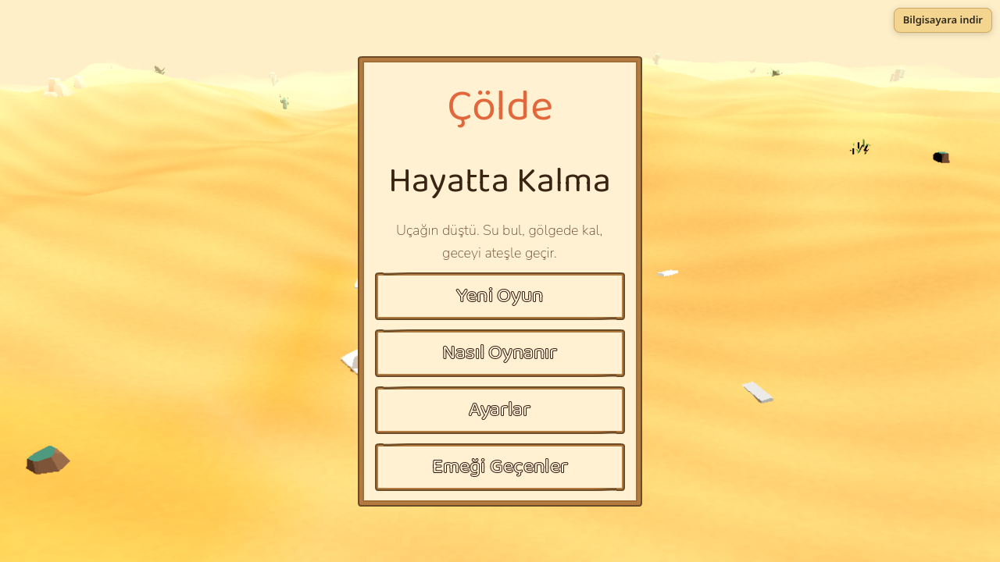
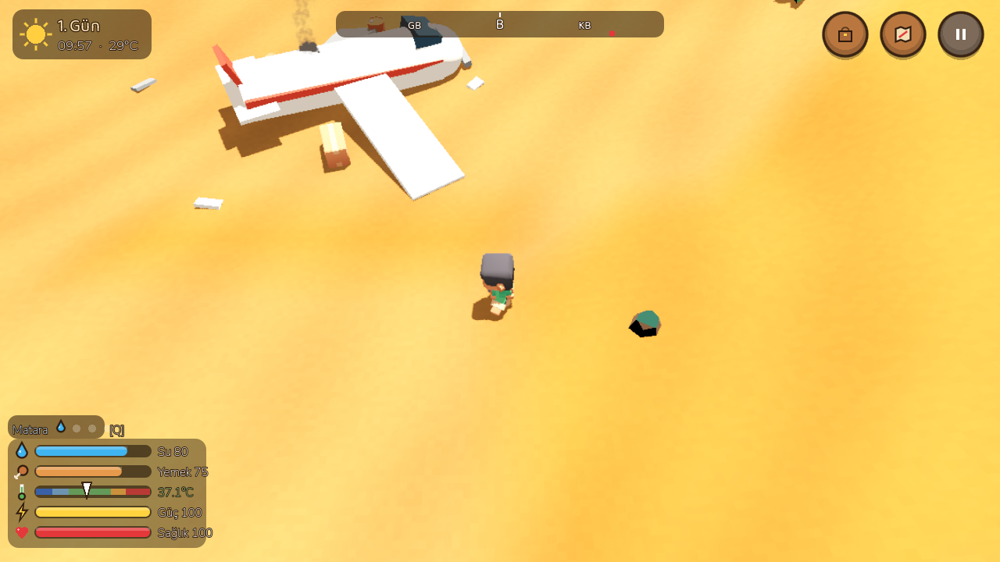
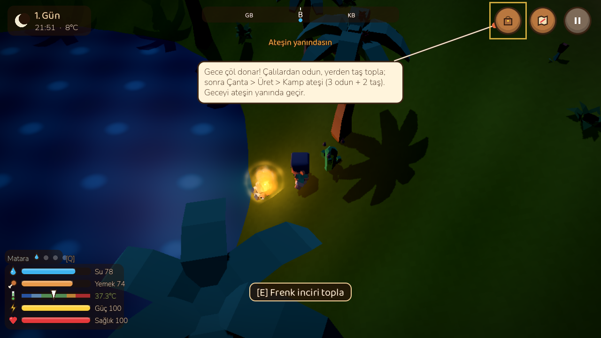
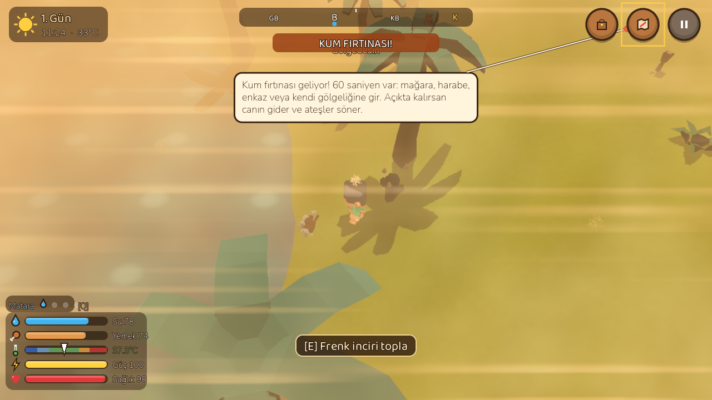
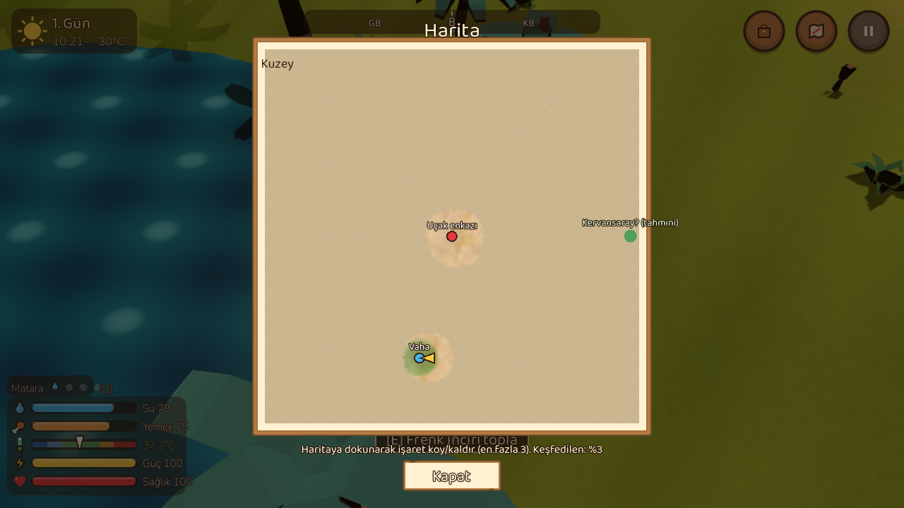
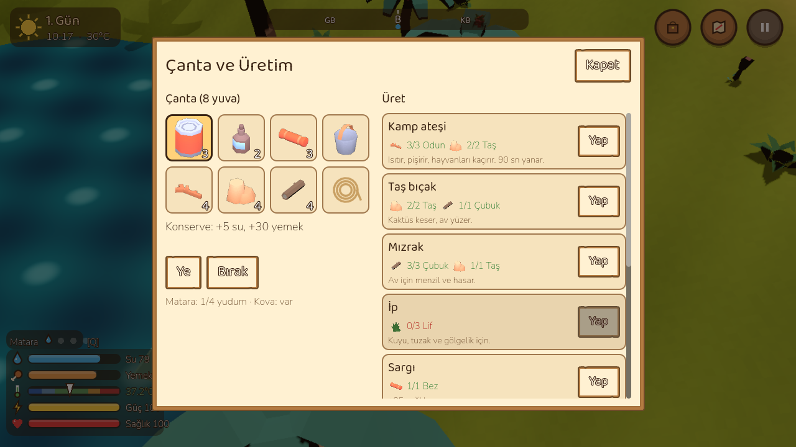

# 🏜️ Çölde Hayatta Kalma

Küçük uçağın çölün ortasına düştü. Elinde yarım bir matara, birkaç konserve ve enkazdan çıkanlar var. Su bul, gölgede kal, geceyi ateşin başında geçir ve kum fırtınalarından korun. Kurtulmanın iki yolu var: telsizi onarıp helikopter çağırmak ya da çölün öbür ucundaki kervansaraya yürümek.

**Oyna:** https://fatihlabsai.github.io/Claude/col-hayatta-kalma/
**Bilgisayara indir (Windows / Linux / macOS):** https://github.com/fatihlabsai/Claude/releases/tag/col-hayatta-kalma-v1.0

Godot 4.7 (GL Compatibility) ile yapıldı. 3D low-poly, sabit 3/4 kamera. Web sürümü tek iş parçacıklıdır, özel sunucu başlığı gerekmez.

## Ekran görüntüleri
| | |
|---|---|
|  |  |
|  |  |
|  |  |

Mobil: [screenshots/mobile.png](screenshots/mobile.png), [screenshots/mobile-inventory.png](screenshots/mobile-inventory.png)

## Nasıl oynanır
- **Hedef:** Hayatta kal. Skor = gün sayısı + keşif yüzdesi.
- **Kurtuluş A, telsiz:** Anten, pil ve devre kartını harabelerden ve mağaralardan topla, enkazdaki telsizi onar, 1 gün dayan. Helikopter enkazın yanına iner.
- **Kurtuluş B, kervansaray:** Haritanın kenarındaki kervansaraya yürü. Yol gölgesiz tuz düzlüğünden geçer; dolu matarayla geceleyin yürümek akıllıca olur.
- **Statlar:** Su, yemek, vücut ısısı, güç (stamina) ve sağlık. Su biterse sağlık hızla düşer. Öğle güneşinde vücut ısın yükselir (sıcak çarpması), gece çöl donar (hipotermi).
- **Gün:** 1 oyun günü 8 dakika: 5 dk gündüz, 3 dk gece. Öğle sıcaklığı her gün 1°C artar.
- **Kum fırtınası:** İlki 2. gün gelir, sonra giderek sıklaşır. 60 sn önceden uyarılırsın. Mağara, harabe, enkaz ya da kendi gölgeliğin seni korur; açıkta canın gider ve ateşler söner. Fırtınadan sonra kumdan erzak sandıkları çıkar.
- **Kaynaklar:** Vahalar (sınırsız su), kuyular (ip ve kova gerekir, bazıları kuru), kaktüs (bıçakla kes), hurma ve frenk inciri, çalılardan odun ve lif, taşlar, larvalar. Tavşan, keklik ve yılan avlanabilir; çakallar geceleri saldırır ama ateşten korkar. Yılan ve akrep zehirler.
- **Üretim (Çanta > Üret):** Kamp ateşi, taş bıçak, mızrak, ip, sargı, çiy toplayıcı, tuzak, gölgelik, deri matara.
- **Harita:** Sisli; gezdiğin yerler açılır. Haritaya dokunarak 3 işaret koyabilirsin. Üstteki pusula şeridi keşfettiğin yerleri gösterir.
- **Zorluk:** Kolay / Normal / Zor (tüketim ×0.75 / ×1 / ×1.3).
- **İlk gün ipuçları:** Matara ile su içme, gölgeye girme, ateş kurup kullanma ve fırtına için konuşma balonları çıkar.
- **Kayıt:** Her yeni günün şafağında otomatik kaydedilir (web'de tarayıcının yerel deposuna). Ana menüde **Devam Et** ile kaldığın yerden, öldüğünde **Son şafaktan devam** ile o günün başından sürdürürsün. Duraklat menüsünde "Kaydet ve Ana Menü" de var.
- **Grafik kalitesi (Ayarlar):** Düşük / Orta / Yüksek: gölgeler, parçacık miktarı, çözünürlük ölçeği ve görüş mesafesi. Dokunmatik cihazlarda varsayılan Düşük, bilgisayarda Orta.

## Kontroller
| Klavye / fare | Dokunmatik |
|---|---|
| WASD / oklar: yürü · Shift: koş | Sol joystick (sonuna kadar itince koşar) |
| E / Space: etkileşim | Etkileşim tuşu |
| Sol tık / F: saldır, avlan | Saldır tuşu |
| Q: matara | İç tuşu |
| Tab / I: çanta ve üretim · M: harita | Üstte Çanta ve Harita |
| 1–4: hızlı yuva · Tekerlek: yakınlaştır | — |
| Esc / P: duraklat | Üstte Duraklat |

## Klasör yapısı
- `index.html`, `index.js`, `index.wasm`, `index.pck` …: web export (GitHub Pages bunu sunar)
- `project/`: Godot kaynak projesi (Godot 4.7 ile açın)
  - `scripts/data.gd`: tüm denge sabitleri, eşyalar ve tarifler
  - `scripts/survival.gd`, `weather.gd`, `world_gen.gd`: oyun ve denge simülasyonunun paylaştığı kurallar
  - `tools/balance_sim.gd`: başsız denge simülasyonu
  - `tools/smoke.gd`: başsız duman testi
- `screenshots/`: ekran görüntüleri
- `CREDITS.md`: tüm varlıklar ve lisansları (hepsi CC0, fontlar OFL)

## Geliştirme
```bash
cd project
godot --headless --import
godot --headless -- --smoke                          # duman testi: başla, yürü, topla, üret, fırtına, kayıt, kazanma, ölüm
godot --headless -s tools/balance_sim.gd -- 12 7     # 12 tohum × 7 gün, dikkatli ve dikkatsiz oyuncu
godot --headless --export-release "Web" ../index.html
```
Masaüstü export presetleri (Windows tek exe, Linux, macOS universal) `export_presets.cfg` içinde; çıktılar repo dışına (`../../../col-builds/`) yazılır. Web sayfasındaki "Bilgisayara indir" bağlantısı Web presetinin `html/head_include` alanındadır, yeniden export edince korunur.

## Denge simülasyonu
`tools/balance_sim.gd` oyunun kendi kurallarıyla (Survival, Weather, WorldGen) iki yapay oyuncuyu oynatır:
- **Dikkatli:** kaynaklardan düzenli su içer, öğlen gölgede dinlenir, gece ateş yakar, fırtınada sığınağa girer.
- **Dikkatsiz:** güneşte koşturur, sadece ara sıra su içer, ateş yakmaz, fırtınayı umursamaz.

Son çalıştırma (12 tohum, Normal, 7 gün): dikkatli oyuncu **12/12 hayatta** (en düşük sağlık 22–100); dikkatsiz oyuncu **0/12**, ortalama 1.34 gün sonra (oyunun 2. gününde) ölüyor; ölüm nedenleri kum fırtınası ve sıcak çarpması.

PLAN.md'deki sayılardan bilinçli sapmalar: sağlık yenilenmesi 0.5 yerine 0.35/sn, vücut ısısı hedefe 0.6 yerine 1.5°C/dk yaklaşıyor, geceler daha soğuk (gece yarısından sonra en düşük −6°C). Bunlar olmadan gece ve öğle sıcağı neredeyse hiç tehlike yaratmıyordu.

## Lisans
Kod: Fatih Kol. Varlıklar: CC0 / OFL, ayrıntılar `CREDITS.md`'de.
